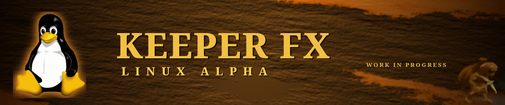

# KeeperFX Launcher — Tux Edition



This is a **Linux-native fork** of the KeeperFX team's settings launcher
([dkfans/keeperfx-launcher-qt](https://github.com/dkfans/keeperfx-launcher-qt)), patched to drive the
**native Linux engine** (no Wine) and to install and update
[KeeperFX Tux Edition](https://github.com/ForkedInTime/keeperfx-linux-alpha).


Browse and install the whole [keeperfx.net](https://keeperfx.net) workshop without leaving the launcher, manage
your mods, install the Unearth map editor, and update the game in place — all on native Linux.

> ⚠️ **Unofficial — not affiliated with the KeeperFX team.** The launcher is *their* work; this fork only adds
> the Linux-native changes below. The official launcher (and the official game) live at
> [dkfans/keeperfx-launcher-qt](https://github.com/dkfans/keeperfx-launcher-qt) and
> [dkfans/keeperfx](https://github.com/dkfans/keeperfx).

---

## 🎮 Players: you don't need this repo

**Just want to play?** Don't build anything here. Grab the single self-contained **AppImage** from the game repo:

→ **[github.com/ForkedInTime/keeperfx-linux-alpha → Releases](https://github.com/ForkedInTime/keeperfx-linux-alpha/releases)**

Download one file, run it, and the only thing it ever asks for is your own *Dungeon Keeper* files. The
launcher (this project) is bundled inside it — engine, libraries, game data and all. No `apt install`, nothing
to set up. It works on any current 64-bit Linux distro (Ubuntu 24.04+/26.x, Fedora, Arch, Steam Deck).

A **Flatpak** and an Arch **AUR** package are also published from the game repo — see its README for those.
The AUR package builds this launcher from source, pinned to the same commit the release's AppImage was built from.

---

## What this fork changes

### Native-Linux plumbing

The team's launcher compiles cross-platform, but it was written Windows-first — it launched the game through
**Wine** and read the version from a Windows `.exe`. This fork makes it drive the **native** engine:

- **`game.cpp`** — launch the native `keeperfx` ELF directly (no Wine) when present; the team's Wine path
  is still compiled in, but only as a fallback for an install with no native engine
- **`helper.h`** — detect the native binary (not just `keeperfx.exe`) as "installed", and open external links
  in a way that survives the AppImage's sandboxed environment
- **`kfxversion.cpp`** — read the engine version from `version.txt` (a native ELF has no PE resources)
- **`apiclient.cpp`** — install and self-update from this fork's GitHub releases, and show this fork's release
  notes in the news panel (the stock panel only knows about the Windows project)
- **`CMakeLists.txt`** — Linux only: Qt linked dynamically, no Windows or macOS build branches

### Linux only — what was removed, and what was left on purpose

The Windows build files are gone: the MinGW cross-build (`Dockerfile.win64s`, `compile-win64s.sh`), the
InnoSetup installer (`windows-installer.iss`), the Win32 resource and its icon (`app.rc`, `res/icon.ico`)
and the Windows 7-Zip library (`ext/7za.dll`). Nothing built or shipped them; every release launcher is
built for Linux by the game repo.

The Windows code inside `src/` (`#ifdef Q_OS_WINDOWS`, the Windows-executable and Wine helpers) stays.
It is compiled out on Linux or never reached there, and the team's launcher fixes are taken into this fork
by cherry-pick, often touching exactly those blocks — removing them would turn every such cherry-pick
into a conflict. A cherry-pick that touches one of the removed files conflicts once; `git rm` settles it.

### Features added on top

The fork has grown well past the porting patches. Everything below is ours, not upstream's:

- **Workshop browser** (`workshopbrowserdialog.cpp`) — browse the full [keeperfx.net](https://keeperfx.net)
  catalogue in-launcher with thumbnails, categories, search and ratings; install with one click. Thumbnails
  and the catalogue are cached on disk (stale-while-revalidate), and downloads fall back to the website when
  the API publishes no file.
- **Installed manager** — a second tab listing what you actually have across `campgns/`, `levels/`,
  `personal/` and `mods/`, distinguishing stock content from your own, with a reversible **Uninstall →
  Restore** backed by a recycle bin.
- **Mod Manager** (`modmanager*.cpp`) — list mods, enable/disable them, persist `mods/load_order.cfg`.
- **Universal installer** (`addoninstaller.cpp`) — one code path that installs mods, campaigns, map packs and
  loose maps from a `.7z`/`.zip`/`.rar`, detecting the format from the file rather than its name and
  coping with the several archive layouts the workshop actually ships. When an install fails it says why
  (a read-only folder on a package-managed install, say) instead of "nothing to install".
- **Safe extraction** (`archiver.cpp`) — no archive the launcher opens, Workshop item or game update, can
  write outside its folder: symbolic links are never restored from an archive. (The 7-Zip library checks a
  link's target only as text, so a chain of links in a hostile Workshop item could otherwise reach your home
  folder.) A corrupt or truncated download is reported as one instead of closing the launcher, and the
  pre-update save backup holds every save, not just the first.
- **Map Editor** (`downloadmapeditordialog.cpp`) — install and launch **Unearth** from the launcher, and get
  offered an update when a newer Unearth appears.
- **Log viewer** (`logviewerdialog.cpp`) — read the engine and launcher logs without hunting for the files.
- **Music recovery** — detect an installation whose `music/` folder is empty, partial or non-standard and
  offer the download, instead of silently playing nothing.
- **Updates, on two channels** (`apiclient.cpp`, `updatedialog.cpp`) — a release-channel setting picks
  **stable** or **alpha**, and the launcher only ever offers releases from the channel you chose (alphas are
  GitHub prereleases; the stable channel never sees them). It downloads the release's small **update patch**
  when one starts from the version you have and the full game package otherwise, and it **keeps the engine
  it is about to replace** under `previous/` (three deep) so saved games written by it stay playable — the
  Flatpak does the same when a bundle update overwrites the engine. A momentary network failure is retried
  rather than read as "up to date".
- **Crash reports carry the right log** (`crashcontext.cpp`) — a report is only sent with a log the failing
  run actually wrote, never a stale one from an earlier session.
- **Single-instance lock** (`main.cpp`) — one launcher at a time; `--allow-multiple` overrides it.
- **UI scale** — scale the whole launcher from 100% up to 200% (110 / 125 / 150 / 200) for readability.
- **Camera settings that survive Save** (`settingsdialog.cpp`) — *Zoom to cursor* and *Rotate around cursor*
  read the config the way the engine does (one word, any case; `ON`, `TRUE`, `YES`, `ENABLED` are on), so an
  unlisted spelling no longer shows empty and is saved as *Never*; the two *keys only* rotate choices write
  `MOVEMENT_KEYS` / `ROTATION_KEYS`, where upstream writes `ON MOVEMENT_KEYS` / `ON ROTATION_KEYS`, which the
  engine reads as *Always*.

### Kept in step with upstream

The team's own launcher work is taken in batches. On the settings dialog that has brought, most
recently, **VSync**, **Relative mouse mode**, the **Multiplayer** tab with the matchmaking server and the multiplayer port (refused when it clashes with the API port), the
cursor-capture switch written to the game config instead of a command-line flag on engines that
understand it, the **Renderer** dropdown (software or OpenGL) and the **Fade when opening the map**
checkbox on the Graphics tab, the **Viewport mode** dropdown, the **Max. zoom distance** slider, the
replay controls (**Max. replay size** and **Keep replays** per campaign, free play and multiplayer,
written under whichever key names the running engine uses), the retired *Command character* field
removed, the **Rotate around cursor** control, the zoom-to-cursor values the
engine actually accepts (`ON`/`OFF`/`WHEEL`), case-insensitive on/off parsing for every boolean game
setting, and sliders that enable Save when moved. Every control is greyed out on an engine that
predates its setting, and only settings the running engine understands are written back. The launcher binary
also carries its version in an ELF section, so a crash report or a package script can read it
without running it.
Their October work is not in yet: the replay browser that replaces *Run packetfile* (the engine still
accepts the `-packetload` that *Run packetfile* passes), the launcher/game version-mismatch notice, and a settings-dialog
layout fix.

### Tests

`tests/run.sh` builds and runs the standalone logic tests (version parsing and channel classification,
archive-shape detection, tree copying, workshop URL handling, crash-report context) straight from source — no
launcher build required. It exits non-zero on failure.

### CI

The release AppImage and Flatpak are built by **`build-appimage.yml` and `build-flatpak.yml` in the
[game repo](https://github.com/ForkedInTime/keeperfx-linux-alpha)**, which clone this repo's **`alpha`**
branch. They live there because a workflow can only be triggered by, and attach assets to, a release in its
own repository. This repo keeps a manual-dispatch copy of
[`build-appimage.yml`](.github/workflows/build-appimage.yml) for launcher-side debugging: it builds a working
AppImage from the current branch without touching any release.

Push launcher work to **both `alpha` and `master`** — `alpha` is what the release build clones.

## 🛠️ Advanced: build from source

You need a C++17 toolchain, CMake 3.24+, Ninja, and **Qt 6.7+** (the launcher uses
`QNetworkRequestFactory`). Ubuntu 24.04 ships Qt 6.4, so install a newer Qt (e.g. via
[aqtinstall](https://github.com/miurahr/aqtinstall)) — the CI workflow shows the exact steps, and pins
**6.8.3**. CPM fetches zlib/bit7z/LIEF automatically.

```bash
cmake -S . -B build -G Ninja -DCMAKE_BUILD_TYPE=Release
cmake --build build -j"$(nproc)"
```

This produces `build/keeperfx-launcher-qt`. The launcher expects to live in the game's install directory
(it reads/writes config and finds the engine there); the AppImage's `AppRun` handles that by running it from a
writable install dir.

The 7-Zip library committed here, `ext/7z.so`, can list a RAR archive but not extract one. Released builds
replace it with a RAR-capable build made by the game repo (`packaging/ci/build-7zip-lib.sh`), so a launcher
built from this repo alone will refuse RAR Workshop items — with a message saying so.

> ⚠️ **Do not drop a locally built binary into an AppImage install.** The AppImage bundles Qt 6.8.3, so a
> binary built against a newer distro Qt dies with `libQt6Core.so.6: version 'Qt_6.x' not found`. Run your
> local build directly against your system Qt instead, and let CI produce the binary that ships.

## Credits & License

The launcher is the work of the **KeeperFX team and the Keeper Klan community**
([dkfans/keeperfx-launcher-qt](https://github.com/dkfans/keeperfx-launcher-qt)), based on
[ImpLauncher](https://keeperfx.net/workshop/item/410/implauncher-beta). This fork adds the Linux-native
patches and the features above.

GNU General Public License v2.0 — same as upstream.
